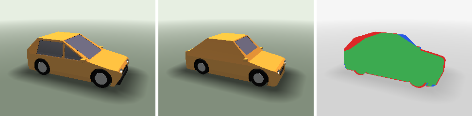

# 3D Gen Model: Photo → CAD with a Language World Model

Given one photo of a car, recover an **editable CAD program**: the parts, the shape of each part, and the order of modelling operations that build it.

The core idea of this project is a **language world model for CAD**. It is a model that reads a modelling state and the next CAD operation, and predicts the resulting state *before the kernel runs it*:

$$
\hat s_{t+1} = W_\phi(s_t, a_t), \qquad s_t = \text{summary of the solid after } t \text{ operations}
$$

A planner $\pi_\theta(a_t \mid \text{image}, s_{\le t})$ writes the program one operation at a time. The world model tells it what each step will do (which part grows or shrinks, by how much, and whether the step will fail), so the planner can check and revise its plan without executing every candidate in a CAD kernel.


*The model writes a CAD program from the photo (left). The kernel executes it (middle). The overlay (right) shows agreement in green, missing material in red and extra material in blue.*

## What is in this repository

| component | file | role |
|---|---|---|
| Procedural car generator | `carworld/params.py`, `carworld/program.py` | 6 body styles, ~19 design parameters, 19–22 operation CAD programs with ground truth for every step |
| Solid-modelling kernel | `carworld/sdf_kernel.py` | numpy signed-distance kernel: prisms, cylinders, intersections; union / cut / intersect; mirroring; per-surface materials; state summaries |
| Renderer | `carworld/render.py` | sphere tracer producing photo-like images, masks and depth, with randomised camera, paint, lighting and background |
| Metrics | `carworld/metrics.py` | silhouette IoU, depth error, voxel IoU, exact Chamfer distance via the SDF |
| CAD export | `carworld/cq_kernel.py` | the same programs as CadQuery scripts → STEP / STL |
| World-model benchmark | `scripts/build_wm_bench.py`, `scripts/run_world_model.py` | (state, operation) → next state, scored against the kernel |
| Planners | `scripts/run_baseline.py` | from parameter search to a vision-language model that writes the whole CAD program |

Coordinates: millimetres, +X front, +Y left, +Z up, ground at z = 0.

## The state and action spaces

**Action:** one JSON operation, for example:

```json
{"step": 4, "name": "arch_front", "part": "body", "mode": "cut", "mirror": true, "material": "arch",
 "tool": {"type": "cylinder", "axis": "Y", "center": [1551.1, 362.9], "radius": 399.0, "extent": [533.4, 933.0]},
 "comment": "Cut the front wheel arch"}
```

**State:** a compact, model-readable summary of the solid. For each part it records the volume in litres, the bounding box and its minimum corner in mm, the share of the surface covered by each material, and left–right symmetry. It also records a `valid` flag and the kernel's error, if any.

The world model predicts the next state in this same format. Because the summary is text, any language model can act as a world model zero-shot, and it can also be fine-tuned on the generator's trajectories.

## Results so far

All numbers are on held-out test cars generated with their own seeds.

### 1. World model: can a model predict what a CAD operation will do?

The benchmark has 220 samples from 20 cars. Besides real build steps, it includes:
- resized tools, so answers cannot be recalled from the template
- cuts that miss the car
- cuts that remove the whole body
- edits of parts that don't exist yet
- malformed tools

| predictor | score | validity acc | failure F1 | change acc | bbox err (mm) |
|---|---|---|---|---|---|
| copy ("nothing happens", the floor) | 0.645* | 73% | 0.00 | 31% | 27 |
| Muse Spark, zero-shot | **0.848** | 93% | 0.89 | 90% | 1 |
| kernel (oracle) | 1.000 | 100% | 1.00 | 100% | 0 |

\*Measured on the same 60 samples as the zero-shot model; it is 0.672 on all 220.

A general model already predicts most failures and most bounding boxes. Volume changes are another matter:
- They are accurate (≈1–2 % error) for cylinder operations such as wheels and arches.
- They are poor for operations whose effect depends on the shape of a 2D outline.

That gap is what training the world model on kernel trajectories is meant to close.

### 2. Planner: photo → CAD

These results use 25 test cars (generator v2.1).

| planner | silhouette IoU | voxel IoU | Chamfer (mm) |
|---|---|---|---|
| mean car (ignores the image) | 0.871 | 0.794 | 59 |
| render-and-compare parameter search | 0.968 | 0.908 | 22 |
| **learned state estimator → template** (one forward pass, no language model) | **0.984** | **0.964** | **9** |
| **model writes the CAD program** (Muse Spark, 4 rounds of render feedback) | 0.922 | 0.786 | 56 |
| model writes the CAD program, no example program in the prompt | 0.899 | 0.707 | 71 |

All 50 first drafts ran in the kernel. Removing the example program costs 0.02 silhouette IoU but 0.08 voxel IoU (`results_v21_noex/`). An earlier parameter-revising loop reached 0.952 silhouette IoU (`results/`, `results_v2/`).

Feedback from the silhouette alone lets the planner match the outline far better than the 3D shape. With no example, the outline beats the average car, but the voxel IoU stays below it.

### 3. Does 3D feedback help the program writer?

This uses the same 25 cars, no example program, and Muse Spark 1.3 (contributor tier) in all three arms (`results_v21_3d/`). After each round the model sees the outline overlay, plus:

| feedback after each round | silhouette IoU | voxel IoU, first draft → final | Chamfer (mm) |
|---|---|---|---|
| outline only (control) | 0.912 | 0.545 → 0.723 | 66 |
| + **its own car's 3D state** (kernel measurements, front/side/top renders) | 0.888 | 0.523 → 0.701 | 75 |
| + **the true car's 3D state** (upper bound, not a method) | 0.928 | 0.533 → 0.789 | 49 |
| + **the 3D state estimated from the photo** (section 4, the full pipeline) | **0.931** | 0.532 → **0.801** | **46** |

- **Its own 3D state does not help.** The change is −0.023 ± 0.021 voxel IoU, paired over 25 cars. It describes the model's own car and carries no new information about the target.
- **The true 3D state helps at once.** The gain is +0.065 ± 0.018 voxel IoU, and the result is better on 20 of 25 cars. Chamfer falls 26 %, and most of the gain comes in the first revision. So the model *can* turn part sizes into correct program edits.

**Key finding:** the bottleneck is perceiving the target's 3D state from the photo, not editing the program. A world model predicts the consequences of the planner's own actions; it cannot add information about the target. The next component is a **state estimator**: photo → the target's per-part sizes and positions. It can be trained on generated cars, where the true state is free, and it plugs into the slot the upper bound used.

Full tables are in `results*/summary.md`. Per-car rows are in `results*/<predictor>.jsonl`.

### 4. A learned state estimator

`scripts/modal_state_estimator.py` trains on a cloud GPU (Modal): 10,000 new generated cars × 2 views, with ResNet-34 + the camera → the car's state summary, its 19 parameters and its body style. Training took about 20 minutes. On the 25 test photos:
- part sizes are within about 2–3 cm (body length 31 mm, width 24 mm, height 16 mm mean error)
- body style is right for 25 of 25 cars

Built with the template, its parameters beat render-and-compare search on every metric, in one forward pass (table above, `est_params`).

**The estimate guides the program writer as well as the truth does.** With the estimated state in its feedback (`vlm_program_est3d`), Muse reaches voxel IoU 0.801 against 0.789 with the true state, a difference of +0.012 ± 0.012. Against the outline-only control it gains +0.077 ± 0.020 and is better on 21 of 25 cars. Chamfer distance falls 31 %. This is a complete photo → CAD-program pipeline in which nothing uses the true car.

Caveats and what's next:
- These results are in-distribution: the estimator is trained on the same generator that made the test cars.
- The program writer is now the bottleneck: 0.801 voxel IoU, against 0.964 for the estimator's parameters built with the template.
- Next: richer target states (cross-sections, occupancy), planner training with the world model, shapes outside the template, and real photos.

Planner runs can execute on Modal, one container per car (`scripts/modal_planner.py`, about 10 min for 25 cars). Store the API key once with `modal secret create meta-api --from-dotenv .env`.

## Setup

```bash
git clone https://github.com/pramodthe/3d_gen_model.git && cd 3d_gen_model
python3 -m venv .venv && source .venv/bin/activate
pip install -r requirements.txt          # numpy + pillow
pip install cadquery                     # optional: OpenCascade kernel + STEP export (or: conda install -c conda-forge cadquery)
```

For language-model experiments, create a `.env` file (it is git-ignored, so never commit it):

```
META_API_KEY=...                 # from dev.meta.ai
META_API_BASE=https://api.meta.ai/v1
MODEL_API_MODEL=muse-spark-1.3
REASONING_EFFORT=low             # low | medium | high
```

Any OpenAI-compatible server works through `--base-url`, `--model` and `--api-key-env`. That includes Fireworks AI and local LM Studio or Ollama servers.

## Reproducing

### Generate data

```bash
python scripts/generate_dataset.py --out data_v21 --split train --n 200 --views 3
python scripts/generate_dataset.py --out data_v21 --split test  --n 25  --views 1
```

It takes about 1 s per car per core. Each car gets `params.json`, `program.json`, `program_cq.py`, `trajectory.jsonl` (state, action, next state, loss weight) and rendered views, masks and depth. The split root holds two training files:
- `planner_sft.jsonl`: image → program
- `world_model.jsonl`: (state, action) → next state

**Loss weighting.** Each world-model turn carries an information weight:
- 0.1 for near no-op turns
- 0.5 for surface-only changes
- 1.0 for real geometry changes and failures

This keeps training focused on turns that say something about the kernel.

### World-model benchmark

```bash
python scripts/build_wm_bench.py --cars 20 --normal-per-car 6 --out data_v21/wm_bench/bench.jsonl
python scripts/run_world_model.py --bench data_v21/wm_bench/bench.jsonl --out results_wm21 --predictor oracle copy
python scripts/run_world_model.py --bench data_v21/wm_bench/bench.jsonl --out results_wm21 --predictor llm --limit 60
```

Metrics:
- validity accuracy and failure F1
- change accuracy
- error in the predicted volume change, relative to the true change
- bounding-box error
- Jaccard overlap of the materials present

### Planners

```bash
python scripts/run_baseline.py --data data_v21/test --predictor oracle mean search --limit 25
python scripts/run_baseline.py --data data_v21/test --predictor vlm_program --limit 25 --resume
```

| predictor | what it does |
|---|---|
| `oracle` | true parameters (sanity check) |
| `mean` / `random` | the average car / a random car |
| `search` | render-and-compare search over parameters (camera known) |
| `vlm`, `vlm_cam` | a vision-language model estimates parameters from the photo (`vlm_cam` is also given the camera) |
| `vlm_loop`, `vlm_loop2`, `vlm_loop3` | render-and-revise loops over parameters |
| `vlm_program` | the model **writes the CAD program**. The kernel runs it, and the model sees kernel errors or its render plus an overlay, then rewrites. `--no-program-example` removes the example program from the prompt |
| `vlm_program_3d` | as `vlm_program`, plus 3D feedback about its own car: the kernel's state summary and front/side/top renders |
| `vlm_program_truth3d` | as `vlm_program_3d`, plus the true car's state summary (upper bound for 3D feedback) |
| `vlm_program_est3d` | as `vlm_program_3d`, plus the state **estimated from the photo** by the trained estimator (the full pipeline) |
| `est_params` | no language model: the estimator's predicted parameters, built with the template |

### Fine-tuning data

`scripts/export_fireworks.py` converts both training files to chat-format JSONL for LoRA fine-tuning.

### Checking the CadQuery export

```bash
python scripts/verify_cadquery.py --data data_v21/test --limit 10 --export
```

This builds each `program_cq.py` with OpenCascade, checks that the volumes match the numpy kernel, and writes `car.step` and `car.stl`.

### Real-shape calibration

`scripts/partverse_find_cars.py` and `scripts/partverse_extract_cars.py` pull car meshes from the PartVerse dataset. The generator's v2 parameter ranges were widened to match the spread of 336 real car models.

## Generator versions

- **v1:** hand-set ranges and 5 styles. Used for `results/`.
- **v2:** ranges calibrated against real car models, a `sports` style, plus bumpers, mirrors, exhaust and a rear wing. Used for `results_v2/` and `results_wm/`.
- **v2.1** (current): fixes two geometry bugs.
  - The glass insets pointed into the body.
  - Low cars could have their tyres poke through the bonnet.

  Used for `results_v21/`, `results_v21_noex/`, `results_v21_3d/` and `results_wm21/`. Every `params.json` records its `generator_version`.

## Roadmap

1. ~~Close the loop with 3D state feedback.~~ Done (section 3 of the results): it only helps when the feedback carries information about the target.
2. ~~Train a state estimator.~~ Done (section 4). Next: use it to guide the program writer, then test on real photos.
3. Fine-tune the world model on generator trajectories and use it in place of the kernel inside the planner's loop.
4. Train the planner with reinforcement learning, with the world model as a cheap simulator.
5. Move from renders to real photos, using segmentation to isolate the car.
